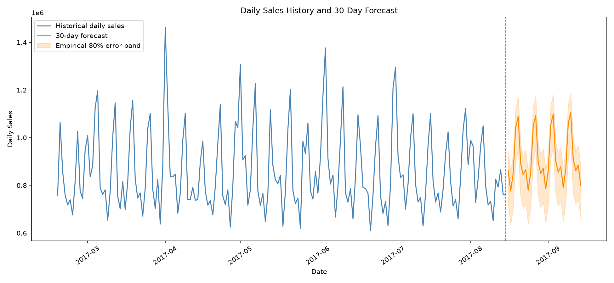

# Retail Sales & Demand Forecasting

A Python project for exploring retail sales patterns, evaluating store-and-product sales predictions, and forecasting daily business-level sales. It combines time-based feature engineering, a machine-learning model, chronological validation, visual analysis, and a Streamlit dashboard.

> **Dataset date warning:** The included Kaggle training data runs from **January 1, 2013 through August 15, 2017**. The checked-in/generated forecast therefore covers **August 16 through September 14, 2017**. This is a demonstration forecast based on historical data, not a forecast for the present day. Use recent sales data to produce a current forecast.

## What it does

- Checks and summarizes the historical sales data.
- Examines average sales by weekday and month.
- Engineers calendar, lag, and rolling-average features for store/product series.
- Trains a `HistGradientBoostingRegressor` and compares it with a weekly seasonal-naive baseline.
- Evaluates a separate daily-total `Ridge` regression using a chronological holdout.
- Produces validation charts, a 30-day forecast, and an empirical error band.
- Provides a Streamlit dashboard for exploring historical predictions and viewing/downloading the daily-total forecast.

## Forecast preview

The chart is generated by `final_EDA.py` and saved to `outputs/daily_sales_forecast.png`.



## Evaluation results

The project has **two different evaluation scopes**. Their metrics use different sales units and should not be compared directly.

### Store/product-family model

`model.py` evaluates predictions for individual store/product-family records over **July 1–31, 2017**. Values below are from the saved validation predictions.

| Metric | Weekly seasonal-naive baseline | HistGradientBoosting model |
|---|---:|---:|
| MAE | 82.52 | **58.33** |
| RMSE | 319.48 | **212.68** |

On this validation set, the model reduces MAE by **29.3%** and RMSE by **33.4%** versus the baseline. These metrics are in the sales units of a single store/product-family record.

### Business-level daily-total forecast

`final_EDA.py` aggregates sales across all stores and product families, then evaluates daily totals on the **90 days from May 18 through August 15, 2017**.

| Metric | Result |
|---|---:|
| MAE | 92,700.91 |
| RMSE | 109,310.65 |
| WAPE | 10.84% |

MAE and RMSE are in total daily sales units. WAPE is the sum of absolute errors divided by total actual sales, expressed as a percentage. The results are available in `outputs/model_evaluation.csv`.

## Requirements

- Python **3.10 or newer**
- The project CSV data files (see [Dataset](#dataset))
- Python packages: `pandas`, `numpy`, `matplotlib`, `seaborn`, `scikit-learn`, `joblib`, and `streamlit`

## Setup

From the project directory, create and activate a virtual environment in PowerShell:

```powershell
py -3 -m venv .venv
.\.venv\Scripts\Activate.ps1
python -m pip install --upgrade pip
python -m pip install pandas numpy matplotlib seaborn scikit-learn joblib streamlit
```

If PowerShell blocks environment activation, run the interpreter directly instead:

```powershell
.\.venv\Scripts\python.exe -m pip install pandas numpy matplotlib seaborn scikit-learn joblib streamlit
```

## Dataset

This project uses the [Corporación Favorita Grocery Sales Forecasting](https://www.kaggle.com/competitions/store-sales-time-series-forecasting) dataset. Download the competition data from Kaggle and place the required files in the project root:

```text
train.csv
stores.csv
```

The other analysis scripts use `transactions.csv` and `holidays_events.csv`. `oil.csv`, `test.csv`, and `sample_submission.csv` are part of the Kaggle dataset but are not required for the basic run sequence below.

The scripts expect the training data to include `date`, `store_nbr`, `family`, and `sales`. `feature.py` and `model.py` additionally use `onpromotion`; `model.py` also joins store `type` and `cluster` from `stores.csv`.

The dataset is not included in this repository. Follow Kaggle's access and dataset terms when downloading or sharing it. Do not commit the large source CSVs or generated feature table to GitHub.

## Run the project

Run commands from the project root, in this order:

```powershell
# 1. Build calendar, lag, and rolling-window features from train.csv.
python feature.py

# 2. Train the store/product model and save its July 2017 validation predictions.
python model.py

# 3. Generate error analysis and validation charts/CSVs.
python analyze.py

# 4. Run aggregate-sales EDA, holdout evaluation, and the future 30-day forecast.
python final_EDA.py

# 5. Launch the dashboard.
python -m streamlit run app.py
```

Open the local URL printed by Streamlit, usually `http://localhost:8501`.

`feature.py` writes `train_features.csv`, which can be large. The feature-generation and model-training steps may take several minutes and need enough disk space and memory. To run only the business-level forecast and its EDA, `final_EDA.py` only needs `train.csv`; it does not depend on the engineered feature table or the model from `model.py`.

## Project files

| File or folder | Purpose |
|---|---|
| `feature.py` | Creates calendar, lag, and rolling features for each store/product family. |
| `model.py` | Trains the store/product-family model, evaluates it against a baseline, and writes validation predictions. |
| `analyze.py` | Analyzes validation errors and saves actual-vs-predicted visualizations and family-level errors. |
| `final_EDA.py` | Checks the source data, explores seasonality, evaluates daily aggregate forecasts, and creates a 30-day forecast. |
| `app.py` | Streamlit dashboard for validation results and the aggregate business-level forecast. |
| `invest.py` | Prints contextual sales, store, transaction, and holiday information for a selected historical spike. |
| `outputs/` | EDA charts, evaluation results, forecast data/model, and the business summary generated by `final_EDA.py`. |
| `train.csv`, `stores.csv`, etc. | Kaggle source data; download separately. |

### Generated forecast outputs

After running `final_EDA.py`, the `outputs/` directory contains:

- `daily_sales_forecast.png` — historical daily sales and 30-day forecast chart.
- `daily_sales_forecast.csv` — forecast dates, predicted sales, and lower/upper empirical error bounds.
- `daily_sales_history.csv` — aggregated daily sales used by the dashboard.
- `model_evaluation.csv` — chronological holdout MAE, RMSE, and WAPE.
- `validation_forecast.csv` and `validation_actual_vs_forecast.png` — holdout predictions and comparison chart.
- `forecast_business_summary.txt` — short planning-oriented summary.
- `daily_sales_forecaster.pkl` — fitted daily-total Ridge model and forecast metadata.
- `weekly_seasonality.png` and `monthly_seasonality.png` — EDA charts.

The dashboard uses generated output files as well as `validation_predictions.csv` and `sales_model.pkl`, which are produced by `model.py`. If the dashboard reports a missing file, run the sequence above to regenerate the artifacts.

## How to interpret the forecast

The daily-total forecast combines a linear time trend with weekday indicators and annual sine/cosine calendar features. The model is fit on the available daily history and predicts the next 30 days. The lower and upper bounds are created by adding the 10th and 90th percentile residuals from the 90-day validation period to each point forecast, then clipping at zero.

Use the prediction as a **planning baseline**, not a guaranteed outcome. The daily-total model does not use planned future promotions, holidays, inventory constraints, or one-off events. Forecast performance can change when the business, product mix, or data period changes.

To generate a forecast for a current business period, prepare an up-to-date `train.csv` with the required columns, then rerun `final_EDA.py` and restart/refresh the dashboard. The forecast date range is derived from the latest date in that file.

## Notes

- Validation uses chronological splits to preserve time ordering.
- Missing dates in the aggregate daily series are filled with zero sales. This reflects dates with no reported sales rows; verify this interpretation before applying the script to another business.
- The model is for demonstration and learning. Validate forecasts with business stakeholders before using them for operational decisions.
